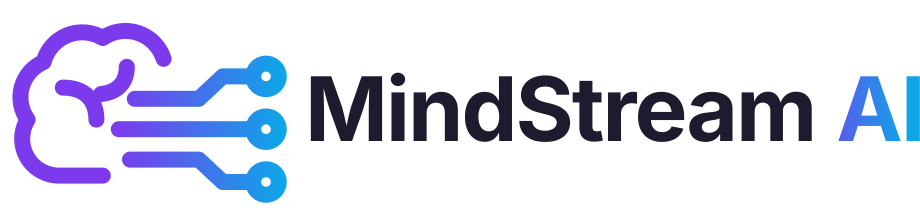
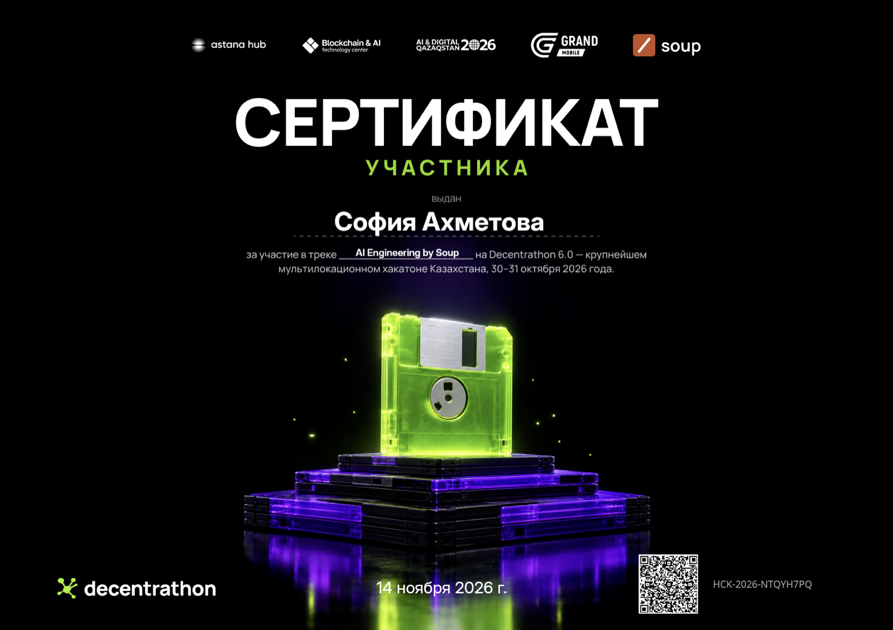

<p align="center"></p>

<h1 align="center">Soup Kernel Challenge · свои Triton-кернелы для Soup</h1>

<p align="center">
  <em>То же обучение Qwen2.5-1.5B на бесплатной Kaggle T4: ≈1,5× быстрее, ≈4,3× меньше памяти, тот же результат</em>
</p>

> **Decentrathon 6.0 · Soup Kernel Challenge** (30–31 октября 2026, соло): свои Triton-кернелы для дообучения LLM на Kaggle T4 — 1,49× быстрее, 4,31× меньше памяти GPU, 10/10 проверок организаторов. **Итог: средняя оценка жюри 61,88 из 100, [сертификат участника](#-итог-хакатона)** (трек AI Engineering by Soup, выдан 14.11.2026). Это публичная копия командного репозитория хакатона со всей историей разработки.

<p align="center">
  
  
  
  
  
  
  
  <a href="#-тесты"></a>
  
  
  
  <a href="./LICENSE"></a>
</p>

<p align="center">
  <a href="https://www.kaggle.com/code/sophieda/mindstream-soup-kernels?scriptVersionId=368085963"><b>📓 Kaggle-ноутбук (10/10 PASS)</b></a> |
  <a href="https://youtu.be/fNUtKUW9vSs"><b>🎬 Демо-видео</b></a> |
  <a href="https://drive.google.com/file/d/1kJC7frksNmOO7wqf6DHUjxd_cLn_TOz8/view?usp=sharing"><b>📑 Презентация</b></a>
  <br/>
  <a href="#-результаты">📊 Результаты</a> |
  <a href="#kernels">⚙️ Кернелы</a> |
  <a href="#-как-запустить">🚀 Запуск</a> |
  <a href="./SUBMISSION.md">📝 SUBMISSION</a> |
  <a href="#-итог-хакатона">🏅 Сертификат</a>
</p>

<p align="center">
  <b>🇷🇺 Русский</b> · <a href="#kk">🇰🇿 Қазақша</a> · <a href="#en">🇬🇧 English</a>
</p>

---

## 💡 Коротко

`soup train` дообучает **Qwen2.5-1.5B-Instruct** (веса NF4, LoRA r=16) на 256 инструкциях на казахском языке на одной Kaggle T4. В базе это ≈ 84 с и 14,3 ГБ видеопамяти — почти вся карта. Наши Triton-кернелы подключаются одной функцией `solution.apply()`, без единого встроенного режима Soup: **то же обучение идёт ≈ 1,5× быстрее и занимает ≈ 4,3× меньше памяти (3,3 ГБ — помещается даже в видеокарту на 4 ГБ: проверено с лимитом памяти на T4)**, а метрики совпадают с базой в пределах её собственного разброса между запусками.

### 🎯 Критерии кейса → где доказательство

| Критерий | Баллы | Наш результат и где проверить |
|---|---|---|
| Допуск: все 10 проверок `harness/check_rules.py` | 20 | **ALL CHECKS PASSED** в [публичном ноутбуке Kaggle](https://www.kaggle.com/code/sophieda/mindstream-soup-kernels?scriptVersionId=368085963) (версия 5, этот репозиторий, коммит `ca77dcc`; на хакатоне — [версия 4](https://www.kaggle.com/code/sophieda/mindstream-soup-kernels?scriptVersionId=363824217), коммит `b1c97d9`) |
| Скорость `soup train`, s | 35·ln s / ln s_best | **1,49×** в ноутбуке, **1,50×** в среднем 2 прогонов — [Результаты](#-результаты) |
| Память GPU, m | 30·ln m / ln m_best | **4,31×**: 14 345 → 3 329 МиБ, проверено и с лимитом 3 ГБ — [Результаты](#-результаты) |
| README: что сделано и откуда идеи, как запустить, результаты и ограничения | 15 | [Что сделано](#️-что-сделано) · [Источники идей](#-источники-идей) · [Как запустить](#-как-запустить) · [Ограничения](#️-ограничения-честно) |
| Качество не хуже базы (eval loss ≤ +0,5 %) | условие допуска | **−0,002 %** и [отчёт о точности по каждому шагу](#-отчёт-о-точности-результат-обучения-не-изменился) |

---

## 📊 Результаты

Официальные скрипты `harness/run_task.py --repeats 2` и `harness/check_rules.py` на Kaggle T4 (база и решение по 2 запуска, как у жюри; средние):

| | База Soup 0.77.0 | MindStream AI | Отношение |
|---|---|---|---|
| Время `soup train` (от запуска до адаптера) | 83,5 с | **55,5 с** | **s ≈ 1,50×** |
| Из них цикл обучения (64 шага) | 57,3 с | **33,2 с** | 1,73× |
| Пик памяти GPU (nvidia-smi) | 14 345 МиБ | **3 329 МиБ** | **m ≈ 4,31×** |
| Eval loss адаптера (строки 40000–40255) | 2,04966 | 2,04962 | **−0,002 %** |
| Доля наших кернелов во времени обучения | — | **10,5 %** | порог 5 % |

**Все 10 проверок `check_rules.py` — PASS.** 31 наш тест кернелов и 79 регрессионных тестов Soup проходят. Разброс замеров на T4 между прогонами — 1–4 %, поэтому округляем: **≈ 1,5× быстрее, ≈ 4,3× меньше памяти**.

📓 **Публичный ноутбук Kaggle** по шаблону организаторов, сдан на хакатон (`COMMIT = "b1c97d9"`, по 1 запуску на сторону): [версия 4](https://www.kaggle.com/code/sophieda/mindstream-soup-kernels?scriptVersionId=363824217) — база 95,7 с → **64,1 с (1,49×)**, 14 345 → **3 329 МиБ (4,31×)**, eval loss 2,04969 → 2,04965 (−0,002 %), доля наших кернелов 10,1 %, **ALL CHECKS PASSED**. Секунды на этой машине Kaggle больше, а отношения те же.

📓 **Повторный запуск из этого публичного репозитория** (10.11.2026, коммит `ca77dcc`, код `solution/` тот же): [версия 5](https://www.kaggle.com/code/sophieda/mindstream-soup-kernels?scriptVersionId=368085963) — база 93,1 с → **58,8 с (1,58×)**, 14 345 → **3 329 МиБ (4,31×)**, eval loss 2,04966 → 2,0497 (+0,002 %), доля наших кернелов 10,5 %, **ALL CHECKS PASSED**. Его можно открыть и запустить (**Copy & Edit → Run All**) без токенов.

🧪 **Проверка «помещается в 4 ГБ».** На той же T4 обучение запущено с жёстким лимитом памяти PyTorch (`torch.cuda.set_per_process_memory_fraction`, без изменений в коде решения): с лимитом **3 500 МиБ** и даже **3 072 МиБ** оно проходит без нехватки памяти, eval loss тот же (2,04964–2,04966), весь процесс по nvidia-smi — 3,2–3,3 ГБ. Это эмуляция маленькой карты на T4, на физической карте 4 ГБ мы не запускали.

### 🎯 Отчёт о точности: результат обучения не изменился

Пошаговые метрики из `trainer_state.json` и `rewind.jsonl` (64 шага, 256 строк). Справа — насколько база отличается **сама от себя** при повторном запуске на той же T4:

| Метрика | Наше vs база: макс / среднее | База vs база (шум T4) | Допуск правил |
|---|---|---|---|
| Loss по шагам | 0,058 % / 0,012 % | 0,030 % / 0,009 % | 3 % |
| Энтропия (лог TRL) | 0,064 % / 0,012 % | 0,038 % / 0,010 % | 3 % |
| Точность токенов (лог TRL) | 0,85 % / 0,12 % | 0,95 % / 0,12 % | 3 % |
| Loss строк в `rewind.jsonl` | 0,45 % / 0,04 % | 0,34 % / 0,03 % | 3 % |
| Loss первого шага | 0,001 % | — | 1 % |
| Число токенов по шагам | совпадает | — | равенство |

Наше отличие от базы — того же порядка, что и разброс базы между запусками. Часть оптимизаций точна **бит в бит** (fp16-эмбеддинги, fp16 в MLP, распаковка NF4), остальные меняют только порядок суммирования в fp32. Маски dropout в LoRA — те же самые, что в базе.

---

<a id="kernels"></a>

## ⚙️ Что сделано

Профиль базового шага на T4: матричные умножения ~36 %, мелкие поэлементные операции и приведения типов ~44 %, softmax по словарю ~7 %. Мы атаковали всё, что не является самим умножением, и убрали лишнюю работу на паддинг.

### Наши Triton-кернелы (`@triton.jit` в `solution/`)

| Кернел | Файл | Что заменяет | Идея |
|---|---|---|---|
| `head_ce_stats_grad_kernel` | [`head_loss.py`](./solution/head_loss.py) | полные логиты `(batch, seq, 151 936)`: fp32-копию для loss, градиент, копию для точности TRL, пересчёт loss строк для rewind | один проход по куску логитов: online log-sum-exp, логит цели, энтропия, argmax; градиент `softmax − one_hot` пишется на место. Полные логиты не существуют |
| `nf4_dequant_kernel` | [`nf4.py`](./solution/nf4.py) | два CUDA-кернела bitsandbytes (распаковка absmax и весов NF4) в каждом forward и backward | за один запуск: восстанавливает двойное квантование absmax на лету и распаковывает 4-битные коды в fp16 |
| `rmsnorm_fwd_kernel`, `rmsnorm_bwd_kernel` | [`rmsnorm.py`](./solution/rmsnorm.py) | 6 отдельных операций Qwen2RMSNorm в forward и ~12 в backward | одна программа на строку, хранит для backward только `1/rms` строки |
| `qkv_prologue_fwd_kernel`, `qkv_prologue_bwd_kernel` | [`rope.py`](./solution/rope.py) | цепочка вокруг q/k/v: каст в fp32, `clone`, сложение с LoRA, 6 операций RoPE, каст обратно в fp16 | сложение base + LoRA и поворот RoPE в регистрах за один проход, тот же порядок округления, что у базы |

### Как ещё мы убрали лишнюю работу и память

| Приём | Файл | Эффект |
|---|---|---|
| **Удаление паддинга внутри батча** | [`unpad.py`](./solution/unpad.py) | реальные токены упаковываются после эмбеддинга; нормы, проекции, MLP и голова работают только по ним. Внимание — по каждой строке отдельно с causal-маской (реальные токены строки идут подряд), что совпадает с маской базы. Строки разных батчей не смешиваются |
| **Те же маски dropout** | [`unpad.py`](./solution/unpad.py) | dropout LoRA тянет случайные числа на развёрнутом тензоре той же формы, что в базе, поэтому маски совпадают |
| **fp16-эмбеддинги бит в бит** | [`tied_embedding.py`](./solution/tied_embedding.py) | на T4 Soup грузит модель в fp16, а PEFT поднимает общую матрицу эмбеддингов/LM head до fp32 — без новых битов информации. Храним её в fp16 (с проверкой точности) и возвращаем fp32 при поиске: −0,9 ГБ |
| **fp16 в MLP** | [`mlp.py`](./solution/mlp.py) | bitsandbytes возвращает результат 4-битного умножения в fp32, и gate/up хранились в fp32. Один каст входа в fp16 даёт те же значения вдвое компактнее: −2 ГБ |
| **Пересчёт MLP только для больших батчей** | [`mlp.py`](./solution/mlp.py) | пик памяти задаёт самый большой батч; для батчей > 800 реальных токенов gate/up не хранятся, а пересчитываются в backward нашим NF4-кернелом. Остальные батчи идут на полной скорости |
| **Фоновая компиляция** | [`warmup.py`](./solution/warmup.py) | наши кернелы компилируются в отдельном потоке, пока Soup загружает модель (кэши при каждом запуске пустые, как требуют правила) |
| **Метрики TRL и rewind Soup без логитов** | [`patches.py`](./solution/patches.py) | энтропия, точность, `num_tokens` и loss строк считаются в нашем кернеле по формулам TRL 0.29.1 и Soup 0.77.0 |

Пример организаторов SwiGLU ([`swiglu.py`](./solution/swiglu.py)) оставлен включённым и в наши кернелы **не засчитывается**.

### Что мы попробовали и отказались (по замерам на T4)

- Пересчёт MLP для **всех** батчей: память −1,2 ГБ, но шаг на 23 % медленнее — по баллам невыгодно.
- Пересчёт «под бюджет» по числу слоёв: пик памяти оказался выше, чем у простого порога.
- Прогрев кернелов-примеров SwiGLU: первый шаг не ускорился — его время уходит на первую загрузку CUDA/cuBLAS-кернелов, а не на Triton.

---

## 🚀 Как запустить

<a id="-kaggle"></a>

**Kaggle (так проверяет жюри):**

1. Kaggle → **Create → New Notebook → File → Import Notebook** → [`templates/kaggle_notebook.ipynb`](./templates/kaggle_notebook.ipynb).
2. Справа: **Accelerator: GPU T4 x2**, **Internet: On**. Репозиторий публичный, токен не нужен.
3. В первой ячейке: `REPO_URL = "https://github.com/s0nakh/soup-triton-kernels.git"`, `COMMIT = ""` (последняя версия).
4. **Run All** (~10 минут): база и решение, `runs/result.json`, таблица проверок.

📓 Публичный ноутбук с результатами: [www.kaggle.com/code/sophieda/mindstream-soup-kernels?scriptVersionId=368085963](https://www.kaggle.com/code/sophieda/mindstream-soup-kernels?scriptVersionId=368085963) (и в [`SUBMISSION.md`](./SUBMISSION.md)).

**Локально (Linux + CUDA GPU):**

```bash
pip install "soup-cli[train]==0.77.0" "transformers==5.16.1" "peft==0.20.0" "trl==0.29.1" \
    "bitsandbytes==0.50.2" "accelerate==1.14.0" pytest
python task/prepare_data.py                        # данные
python -m pytest solution -q                       # наши кернелы против PyTorch / bitsandbytes
SOUP_APPLY_SOLUTION=1 python -m pytest tests -q    # 79 тестов Soup с нашими патчами
python harness/run_task.py --repeats 2             # база и решение → runs/result.json
python harness/check_rules.py                      # проверки → runs/checks.json
```

---

## 🧪 Тесты

| Файл | Что проверяет |
|---|---|
| [`test_head_loss.py`](./solution/test_head_loss.py) | loss, градиент, энтропия, loss по токенам, точность против PyTorch; паддинг; первый максимум в argmax |
| [`test_nf4.py`](./solution/test_nf4.py) | распаковка NF4 и 4-битный слой против самого bitsandbytes (forward и градиент) |
| [`test_rmsnorm.py`](./solution/test_rmsnorm.py) | RMSNorm fp32/fp16 против формулы Qwen2, forward и градиент |
| [`test_rope.py`](./solution/test_rope.py) | пролог LoRA + RoPE + каст против операций Qwen2, forward и оба градиента |
| [`test_unpad.py`](./solution/test_unpad.py) | упакованный forward/backward крошечной Qwen2 против обычного; те же маски dropout |
| [`test_mlp.py`](./solution/test_mlp.py) | MLP с пересчётом против обычного пути на настоящих NF4-слоях |
| [`test_tied_embedding.py`](./solution/test_tied_embedding.py) | fp16-эмбеддинги: поиск совпадает бит в бит, связь с LM head сохраняется |
| [`tests/`](./tests) | 79 регрессионных тестов Soup с нашими патчами |

---

## ⚠️ Ограничения (честно)

- **≈ 19 с из 55 — не наши:** импорт библиотек (~13 с), загрузка 4-битной модели (~3 с), подготовка данных и сохранение. Кернелами это не ускорить, поэтому общее ускорение (1,5×) меньше ускорения самого цикла обучения (1,73×).
- **Первый шаг** у нас ~2,8 с против ~1,2 с у базы: первая загрузка CUDA/cuBLAS-кернелов под новые формы. Устранить не удалось.
- **Матричные умножения** остаются на cuBLAS: свой Triton-GEMM с распаковкой NF4 на T4 (Turing) мы не делали — риск проиграть cuBLAS по скорости.
- **«Помещается в 4 ГБ»** проверено эмуляцией — жёстким лимитом памяти PyTorch на той же T4 (3 500 и 3 072 МиБ); на физической карте 4 ГБ не запускали.
- **Пол памяти ~1,6 ГБ** — сами 4-битные веса, fp16-эмбеддинги и контекст CUDA. Ниже можно только выгрузкой в RAM или полным пересчётом слоёв, а это стоит скорости.
- Удаление паддинга рассчитано на обычный паддинг (реальные токены строки идут подряд); иначе внимание идёт прежним путём на развёрнутом батче.
- Рассчитано на Qwen2 + bitsandbytes NF4 с двойным квантованием + fp16 (конфиг задачи); в других случаях патчи передают управление исходному коду.

---

## 📚 Источники идей

- E. Wijmans et al., *Cut Your Losses in Large-Vocabulary Language Models* (2024) — не материализовать логиты большого словаря.
- [Liger-Kernel](https://github.com/linkedin/Liger-Kernel): fused linear cross-entropy и fused RMSNorm — идеи, код не использовался.
- M. Milakov, N. Gimelshein, *Online normalizer calculation for softmax* (2018) — online log-sum-exp.
- T. Dettmers et al., *QLoRA* (2023) — формат NF4 и двойное квантование.
- J. Su et al., *RoFormer* (2021) — rotary embedding.
- [Unsloth](https://unsloth.ai/blog/long-context) и [Axolotl LoRA optimizations](https://docs.axolotl.ai/docs/lora_optims.html) — идея сливать LoRA с соседними операциями и пересчитывать активации в своём коде.

Весь код кернелов написан с нуля. Готовые кернел-библиотеки не используются (проверка 2).

---

## 🗂 Структура

| Путь | Что это |
|---|---|
| `solution/` | наши кернелы, `apply()` и тесты |
| `harness/`, `tests/`, `task/` | скрипты организаторов — не изменяются |
| `templates/` | Kaggle-ноутбук и `SUBMISSION.md` |
| `assets/` | логотип команды |

---

## 👤 Команда

**MindStream AI** — соло-участник: **Sonia Akhsen**, капитан команды · Актау

### 🏅 Итог хакатона

| Средняя оценка жюри | Сертификат | Трек | Выдан |
|:---:|:---:|:---:|:---:|
| **61,88 / 100** | участника Decentrathon 6.0 | AI Engineering by Soup | 14.11.2026 |

<p align="center">
  <a href="./assets/decentrathon6-certificate.pdf"></a>
  <br/>
  <sub>Нажмите на изображение, чтобы открыть PDF</sub>
</p>

Разработка велась с AI-ассистентом [Claude Code](https://claude.com/claude-code). Озвучка демо-видео — [ElevenLabs](https://elevenlabs.io) (бесплатный тариф), голос Victoriya Voloshina — Curious Educator. Слайды презентации сгенерированы в Google NotebookLM (Gemini) по нашему тексту; цифры на них проверены и исправлены вручную.

## 📄 Лицензия

Apache-2.0, см. [`LICENSE`](./LICENSE) и [`NOTICE`](./NOTICE). Шаблон, скрипты `harness/` и тесты — от организаторов кейса (тесты из Soup v0.77.0, Apache-2.0). Данные: [AmanMussa/kazakh-instruction-v2](https://huggingface.co/datasets/AmanMussa/kazakh-instruction-v2) (MIT), перевод [Stanford Alpaca](https://huggingface.co/datasets/tatsu-lab/alpaca) (CC BY-NC 4.0). Модель: [Qwen/Qwen2.5-1.5B-Instruct](https://huggingface.co/Qwen/Qwen2.5-1.5B-Instruct) (Apache-2.0).

---

<a id="kk"></a>
<details>
<summary><b>🇰🇿 Қазақша</b> — ашу үшін басыңыз</summary>

### 💡 Қысқаша

`soup train` бір Kaggle T4-те **Qwen2.5-1.5B-Instruct** моделін (NF4 салмақтары, LoRA r=16) қазақ тіліндегі 256 нұсқаулықта оқытады: базада ≈ 84 с және 14,3 ГБ бейнежад. Біздің Triton-кернелдеріміз Soup-қа бір `solution.apply()` функциясымен, Soup-тың бірде-бір кірістірілген режимінсіз қосылады: **сол оқыту ≈ 1,5× жылдам және ≈ 4,3× аз жад алады (3,3 ГБ — 4 ГБ бейнекартаға да сыяды)**, ал метрикалар базамен оның өз іске қосулары арасындағы шашырау шегінде сәйкес келеді.

### 📊 Нәтижелер (Kaggle T4, әр тарап 2 рет іске қосылды)

| | База | MindStream AI | Қатынас |
|---|---|---|---|
| `soup train` уақыты | 83,5 с | **55,5 с** | **≈ 1,50×** |
| GPU жадының шыңы | 14 345 МиБ | **3 329 МиБ** | **≈ 4,31×** |
| Адаптердің eval loss-ы | 2,04966 | 2,04962 | −0,002 % |

`check_rules.py`-дің барлық 10 тексерісі — PASS. Ұйымдастырушылар үлгісі бойынша жария Kaggle ноутбугы: [5-нұсқа](https://www.kaggle.com/code/sophieda/mindstream-soup-kernels?scriptVersionId=368085963) (осы жария репозиторийден, `ca77dcc`) — 93,1 с → 58,8 с (1,58×), 14 345 → 3 329 МиБ (4,31×), ALL CHECKS PASSED; хакатонға тапсырылған [4-нұсқа](https://www.kaggle.com/code/sophieda/mindstream-soup-kernels?scriptVersionId=363824217) — 95,7 с → 64,1 с (1,49×). 🎬 [Демо-бейне](https://youtu.be/fNUtKUW9vSs) · 📑 [Презентация](https://drive.google.com/file/d/1kJC7frksNmOO7wqf6DHUjxd_cLn_TOz8/view?usp=sharing). Жад шегі тексерілді: сол T4-те PyTorch жадына қатаң шек қойылғанда (3 500 және 3 072 МиБ) оқыту жадсыз қалмай өтеді, eval loss өзгермейді (физикалық 4 ГБ картада іске қосылмаған, бұл T4-тегі эмуляция). Дәлдік есебі [жоғарыда](#-отчёт-о-точности-результат-обучения-не-изменился): біздің базадан айырмашылығымыз базаның өзінің қайта іске қосулар арасындағы шашырауымен бірдей.

### ⚙️ Не істелді

- **Біріктірілген cross-entropy** (`head_loss.py`): 151 936 токендік сөздік бойынша толық логиттер жадта сақталмайды; loss, энтропия, дәлдік және rewind жолдарының loss-ы бір өтімнен алынады.
- **NF4 салмақтарын ашу** (`nf4.py`), **RMSNorm** (`rmsnorm.py`), **LoRA + RoPE + fp16 бір өтімде** (`rope.py`) — өз Triton-кернелдеріміз.
- **Батч ішіндегі padding-ті алып тастау** (`unpad.py`), **fp16 эмбеддингтер биттен битке** (`tied_embedding.py`), **MLP-да fp16 және үлкен батчтарда қайта есептеу** (`mlp.py`).

Толығырақ — [орысша бөлімде](#kernels).

### 🚀 Іске қосу

Kaggle: [`templates/kaggle_notebook.ipynb`](./templates/kaggle_notebook.ipynb) импорттаңыз → GPU T4 x2, Internet On → бірінші ұяшыққа `REPO_URL` және `COMMIT` → **Run All** (~10 минут). Жергілікті командалар [жоғарыда](#-как-запустить).

### 📚 Идеялар көздері

Cut Cross-Entropy (Wijmans et al., 2024), Liger-Kernel, online softmax (Milakov & Gimelshein, 2018), QLoRA (Dettmers et al., 2023), RoFormer (Su et al., 2021), Unsloth және Axolotl. Кернел коды нөлден жазылған.

### 👤 Команда

**MindStream AI** — жеке қатысушы: **Sonia Akhsen**, команда капитаны · Ақтау

🏅 Хакатон қорытындысы: **әділқазылардың орташа бағасы 61,88 / 100**, Decentrathon 6.0 [**қатысушы сертификаты**](./assets/decentrathon6-certificate.pdf) (AI Engineering by Soup трегі, 14.11.2026).

Демо-бейненің дыбысы — [ElevenLabs](https://elevenlabs.io) (тегін тариф), Victoriya Voloshina — Curious Educator дауысы. Презентация слайдтары Google NotebookLM (Gemini) арқылы біздің мәтін бойынша жасалды, сандары қолмен тексерілді.

</details>

<a id="en"></a>
<details>
<summary><b>🇬🇧 English</b> — click to expand</summary>

### 💡 Summary

`soup train` fine-tunes **Qwen2.5-1.5B-Instruct** (NF4 weights, LoRA r=16) on 256 Kazakh-language instructions on one Kaggle T4: ≈ 84 s and 14.3 GB of GPU memory in the base run. Our Triton kernels plug in through a single `solution.apply()`, without any of Soup's built-in modes: **the same training runs ≈ 1.5× faster in ≈ 4.3× less memory (3.3 GB — it fits even a 4 GB GPU)**, and the metrics match the base within the base's own run-to-run spread.

### 📊 Results (Kaggle T4, 2 runs per side, as the jury runs)

| | Base | MindStream AI | Ratio |
|---|---|---|---|
| `soup train` time | 83.5 s | **55.5 s** | **≈ 1.50×** |
| Peak GPU memory | 14,345 MiB | **3,329 MiB** | **≈ 4.31×** |
| Adapter eval loss | 2.04966 | 2.04962 | −0.002 % |

All 10 checks of `check_rules.py` pass. Public Kaggle notebook from the organizers' template: [version 5](https://www.kaggle.com/code/sophieda/mindstream-soup-kernels?scriptVersionId=368085963) (run from this public repository, `ca77dcc`) — 93.1 s → 58.8 s (1.58×), 14,345 → 3,329 MiB (4.31×), ALL CHECKS PASSED; the [version 4](https://www.kaggle.com/code/sophieda/mindstream-soup-kernels?scriptVersionId=363824217) submitted at the hackathon — 95.7 s → 64.1 s (1.49×). 🎬 [Demo video](https://youtu.be/fNUtKUW9vSs) · 📑 [Slides](https://drive.google.com/file/d/1kJC7frksNmOO7wqf6DHUjxd_cLn_TOz8/view?usp=sharing). Memory-limit check: on the same T4 with a hard PyTorch memory cap of 3,500 MiB and even 3,072 MiB, training runs without running out of memory and the eval loss is unchanged (emulated on the T4; not run on a physical 4 GB card). The accuracy report is [above](#-отчёт-о-точности-результат-обучения-не-изменился): our difference from the base is the same size as the base's difference from itself between runs (loss 0.012 % vs 0.009 % mean per step).

### ⚙️ What we built

- **Fused LM-head cross-entropy** (`head_loss.py`): the logits over the 151,936-token vocabulary never exist in full; loss, entropy, accuracy and rewind row losses come from one pass.
- **NF4 dequantization** (`nf4.py`), **RMSNorm** (`rmsnorm.py`), **LoRA + rotary + fp16 cast in one pass** (`rope.py`) — our Triton kernels, forward and backward.
- **Padding removed inside each batch** (`unpad.py`, same dropout masks as the base), **bit-exact fp16 tied embedding** (`tied_embedding.py`), **fp16 MLP intermediates and recomputation for large batches only** (`mlp.py`).

Details are in the [Russian section](#kernels).

### 🚀 How to run

Kaggle: import [`templates/kaggle_notebook.ipynb`](./templates/kaggle_notebook.ipynb) → GPU T4 x2, Internet On → set `REPO_URL` and `COMMIT` in the first cell → **Run All** (~10 minutes). Local commands are [above](#-как-запустить).

### 📚 Sources of ideas

Cut Cross-Entropy (Wijmans et al., 2024), Liger-Kernel, online softmax (Milakov & Gimelshein, 2018), QLoRA (Dettmers et al., 2023), RoFormer (Su et al., 2021), Unsloth and Axolotl. The kernel code is written from scratch.

### 👤 Team

**MindStream AI** — solo participant: **Sonia Akhsen**, team captain · Aktau, Kazakhstan

🏅 Hackathon outcome: **average jury score 61.88 / 100**, Decentrathon 6.0 [**participant certificate**](./assets/decentrathon6-certificate.pdf) (AI Engineering by Soup track, 14 Nov 2026).

Demo video voiceover: [ElevenLabs](https://elevenlabs.io) (free plan), voice Victoriya Voloshina — Curious Educator. Presentation slides generated in Google NotebookLM (Gemini) from our text; the numbers on them were checked and corrected by hand.

</details>
